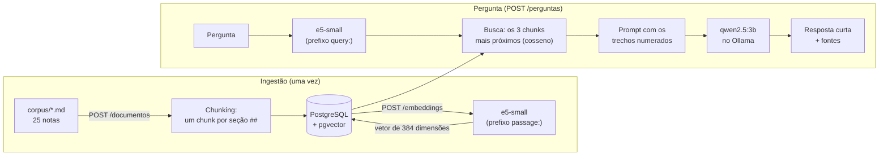

# Assistente de Algoritmos e Estruturas de Dados (RAG)

API que responde dúvidas de iniciantes em Algoritmos e Estruturas de Dados (AED) com base em 25 notas, escritas com auxílio de IA e revisadas à mão, a partir das dúvidas mais comuns nas monitorias da disciplina. A resposta é gerada por um LLM local, o `qwen2.5:3b` no Ollama, usando só os trechos que a busca vetorial (PostgreSQL + pgvector) encontrou, e cita a nota e a seção de onde veio.

O projeto foi feito para ser simples de explicar: SQL escrito à mão, sem ORM, sem framework de RAG, e uma interface pequena entre a busca e o LLM.

<!-- PRINT: tela do /docs com as rotas da API (por exemplo, docs/img/docs.png) -->

## Como funciona



1. **Ingestão:** cada nota em Markdown tem um cabeçalho YAML (título, linguagem e tópicos) e de 3 a 5 seções `##`. Cada seção vira um chunk, com o título da nota e o da seção no começo, para fazer sentido sozinha.
2. **Embeddings:** o `intfloat/multilingual-e5-small` transforma cada chunk num vetor de 384 dimensões, guardado na coluna `vector(384)` do pgvector.
3. **Busca:** a pergunta vira um vetor do mesmo jeito, e o banco devolve os 3 chunks mais próximos pela distância de cosseno (o operador `<=>` do pgvector).
4. **Resposta:** o LLM recebe a pergunta e os 3 trechos numerados, com a instrução de responder em poucas frases, usar só os trechos e dizer "Não sei responder isso com base nas notas." quando nenhum trecho trata do assunto. A API devolve a resposta e a lista de fontes (nota e seção).

**Por que estas escolhas:**
- **Busca e LLM locais:** o projeto roda numa máquina com 8 GB de RAM e uma GPU de 6 GB, sem serviço pago. O Ollama roda fora do Docker, para usar a GPU.
- **`pg8000` como driver:** é escrito só em Python. O Smart App Control do Windows bloqueou as DLLs do `psycopg[binary]`.
- **Um chunk por seção:** as notas foram escritas para cada seção fazer sentido sozinha, e essa configuração foi a que teve mais acertos nos experimentos (veja abaixo).
- **O provedor do LLM fica atrás de uma interface,** `gerar_resposta(pergunta, contexto)` em `app/geracao/base.py`, escolhida pelo `.env`. Hoje, só o Ollama está implementado.

## Resultados

### Busca: recall@3
A métrica principal é o **recall@3**: a fração das perguntas em que pelo menos um dos 3 chunks devolvidos vem da seção certa. Cada pergunta é rotulada com a nota e a seção que a respondem.

São **79 perguntas escritas e rotuladas à mão**:
- 53 principais;
- 23 variantes com erro de digitação ("identação", "pq", acento faltando), cada uma com o mesmo rótulo da sua principal;
- 3 sem resposta no corpus, que ficam fora do recall.

O conjunto foi montado na etapa 10, depois das notas, a partir das 56 perguntas de rascunho, que foram escritas antes das notas. As 56 entraram todas: 55 sem mudança e 1 só com um acento a mais. Nas 23 que tinham erro de digitação, a versão do rascunho virou a variante, e a versão correta, que é a principal, foi escrita na etapa 10, por quem já conhecia o corpus. Os rótulos de todas também foram dados nessa etapa.

Com 53 perguntas, **cada pergunta vale 1,9 ponto**. Por isso, os acertos aparecem junto da porcentagem. Uma diferença de 1 ou 2 perguntas entre duas configurações não permite dizer que uma é melhor.

**As 6 combinações de modelo de embedding × tamanho de chunk** (k=3). O chunking é o máximo de palavras por chunk / o overlap. "Sem limite" é um chunk por seção.

| Modelo | Chunking | Chunks | Cortados pelo limite de tokens | Principais (53) | Variantes (23) | Principais com variante (23) |
|---|---|---|---|---|---|---|
| MiniLM | 40/8 | 484 | 2% | 58,5% (31) | 30,4% (7) | 34,8% (8) |
| MiniLM | 60/10 | 324 | 31% | 58,5% (31) | 34,8% (8) | 34,8% (8) |
| MiniLM | sem limite | 107 | 100% | 60,4% (32) | 52,2% (12) | 39,1% (9) |
| e5-small | 40/8 | 484 | 0% | 66,0% (35) | 52,2% (12) | 47,8% (11) |
| e5-small | 60/10 | 324 | 0% | 73,6% (39) | 65,2% (15) | 60,9% (14) |
| **e5-small** | **sem limite** | **107** | **0%** | **77,4% (41)** | **82,6% (19)** | **69,6% (16)** |

O MiniLM é o `sentence-transformers/paraphrase-multilingual-MiniLM-L12-v2`, que lê no máximo 128 tokens. O e5-small é o `intfloat/multilingual-e5-small`, que lê até 512. "Cortados" é a parte dos chunks que passa desse limite: o fim do texto é ignorado no cálculo do vetor, sem erro nenhum.

- **O e5 ficou acima do MiniLM nas 3 configurações.** O pior resultado do e5 (35) tem 3 acertos a mais que o melhor do MiniLM (32).
- **No MiniLM, o tamanho do chunk não fez diferença mensurável** (31, 31 e 32).
- **No e5, o recall subiu com o tamanho do chunk** (35, 39 e 41). Entre o 60/10 e o "sem limite", a diferença é de 2 perguntas, dentro do que a amostra não permite separar.
- **A configuração escolhida foi o e5-small sem limite.** Ela teve o maior número em todas as colunas, não corta nenhum chunk (o maior tem 411 tokens) e não deixa a mesma seção ocupar mais de uma das 3 posições. Com 40/8 e 60/10, isso aconteceu em 10 a 14 dos erros.
- **Erros de digitação:** a coluna "principais com variante" é a comparação justa, porque usa as mesmas 23 perguntas das variantes. Com o e5 sem limite, nenhum erro de digitação fez a busca errar uma pergunta que a versão correta acertava: 16 pares acertaram nas duas versões, 4 erraram nas duas e 3 acertaram só na variante. Com 23 pares, isso é uma observação, e não uma conclusão.

<!-- PRINT: saída do python -m avaliacao.avaliar com a configuração final (por exemplo, docs/img/avaliar.png) -->

**A primeira medição e a revisão dos rótulos.** A primeira rodada, com o MiniLM e o 60/10, deu **54,7% (29 de 53)**. Depois dela, o rótulo de uma pergunta se mostrou errado, e os rótulos das 76 perguntas com resposta foram revisados à mão. Mudaram 2 seções, nas perguntas 4 e 78, e a mesma configuração passou a dar **58,5% (31 de 53)**. As 2 perguntas tinham errado na primeira rodada e passaram a acertar. É o viés de revisar depois de ver os erros, porque um rótulo errado só aparece quando a pergunta erra. A tabela acima usa os rótulos revisados, e os resultados de todas as rodadas estão em `avaliacao/resultados/`.

### Com e sem RAG
A mesma pergunta, "Por que o índice de vetores em C começa em 0?", feita ao mesmo `qwen2.5:3b`:

**Sem RAG** (18/11/2026, direto no Ollama, sem contexto e sem prompt de sistema; `temperature` não registrada). A resposta tem 350 palavras (as respostas com RAG têm 51 e 86) e vários erros. A íntegra está em [`avaliacao/baseline_sem_rag.md`](avaliacao/baseline_sem_rag.md). Os problemas:
- diz que os arrays de C são "tipados dinamicamente", mas C tem tipagem estática;
- diz que C++ conta a partir de 1, mas C++ também começa em 0;
- diz que C deixa o programador escolher o índice inicial, e não deixa;
- não dá o motivo principal: o índice é o deslocamento a partir do início, porque `v[i]` é o mesmo que `*(v + i)`.

**Com RAG, na configuração da etapa 6** (23/11/2026: MiniLM, 60/10, k=3, prompt antigo, `temperature` 0.1, `num_predict` 256; em [`avaliacao/baseline_com_rag.json`](avaliacao/baseline_com_rag.json)):
> Por que o índice de vetores em C começa em 0, é porque o índice é um deslocamento a partir do início. O primeiro elemento está exatamente no início, então o deslocamento até ele é zero. Por isso, o primeiro elemento é `v[0]`, o segundo é `v[1]`, e assim por diante.

Fonte: `indice-zero.md` > "O índice de um vetor em C é um deslocamento a partir do início".

**Com RAG, na configuração final** (25/11/2026: e5-small sem limite, k=3, prompt atual, `temperature` 0.1, `num_predict` 400; em [`avaliacao/baseline_com_rag_config_final.json`](avaliacao/baseline_com_rag_config_final.json)):
> Por que o índice de vetores em C começa em 0? Porque a expressão `v[i]` é definida como `*(v + i)`, onde `v` é um ponteiro para o primeiro elemento do vetor. Isso significa que o primeiro elemento do vetor está no endereço `v`, e o segundo no endereço `v + 1`, e assim por diante. Portanto, o índice 0 se refere ao próprio primeiro elemento do vetor. Além disso, o último índice válido de um vetor em C é o tamanho do vetor menos 1.

Fontes: 3 seções de `indice-zero.md`.

As duas respostas com RAG estão certas e curtas, e as duas começam repetindo a pergunta.

<!-- PRINT: uma resposta do POST /perguntas com as fontes (por exemplo, docs/img/perguntas.png) -->

### Geração: o que foi observado
A qualidade das respostas não tem métrica. Ela foi observada em 18 perguntas com a configuração final: 10 usadas para ajustar o prompt e 8 novas. Também foram testadas as 3 perguntas sem resposta no corpus.
- **Funciona bem:**
  - as respostas são curtas (de 10 a 135 tokens) e nenhuma foi cortada;
  - o modelo não copia os exemplos de código inteiros;
  - perguntas que as notas não respondem recebem "Não sei responder isso com base nas notas." (Dijkstra, árvore AVL e 2 das 3 perguntas sem resposta).
- **Limitações do modelo de 3B:**
  - **inventa quando os trechos são de um assunto vizinho:** explicou o quicksort e a diferença entre `i++` e `++i` com o próprio conhecimento, e nesta segunda errou, dizendo que a ordem "pode alterar o comportamento do laço";
  - **às vezes não usa o que o trecho diz:** em "Dois for um dentro do outro é sempre O(n²)?", o trecho certo, que fala do O(n × m), estava entre os recebidos, e a resposta ficou vaga nas 3 execuções;
  - **a mesma pergunta pode ter respostas diferentes:** a mesma rodada foi feita 3 vezes, e 7 das 10 respostas mudaram o texto. Numa delas, a resposta sobre liberar uma lista encadeada voltou a um erro antigo;
  - **repete a pergunta no começo, quase não cita o número do trecho ([1]) e usa termos em inglês** ("stack overflow").

## Como rodar

### Pré-requisitos
- **Docker** com Docker Compose.
- **[Ollama](https://ollama.com)** instalado na máquina, fora do Docker, com o modelo baixado:
  ```
  ollama pull qwen2.5:3b
  ```
- **Git.**

### Com o Docker Compose
1. **Clone o repositório e crie o `.env`** a partir do modelo:
   ```
   git clone https://github.com/EduardoAM31/assistente-aed.git
   cd assistente-aed
   cp .env.example .env
   ```
   No PowerShell, troque `cp` por `Copy-Item`. **Se a porta 5432 já estiver ocupada** por um PostgreSQL instalado na máquina, troque o `POSTGRES_PORT` do `.env` (por exemplo, para `5433`). Essa é só a porta publicada: dentro do Compose, a API fala com o banco pela porta interna.
2. **Suba o banco e a API:**
   ```
   docker compose up -d --build
   ```
   A primeira montagem baixa o `torch` (só a versão para CPU) e as dependências. A imagem tem cerca de 2,1 GB. A API fica em `http://localhost:8000`, e a documentação das rotas, em `http://localhost:8000/docs`.
3. **Carregue as 25 notas e gere os vetores.** No primeiro `POST /embeddings`, o e5-small é baixado do Hugging Face e fica guardado no volume `modelos`.

   No PowerShell:
   ```powershell
   Get-ChildItem corpus\*.md | ForEach-Object { curl.exe -s -o NUL -w "%{http_code} $($_.Name)`n" -F "arquivo=@$($_.FullName);type=text/markdown" http://localhost:8000/documentos }
   curl.exe -s -X POST http://localhost:8000/embeddings
   ```
   No Bash (Linux ou macOS):
   ```bash
   for f in corpus/*.md; do curl -s -o /dev/null -w "%{http_code} $f\n" -F "arquivo=@$f;type=text/markdown" http://localhost:8000/documentos; done
   curl -s -X POST http://localhost:8000/embeddings
   ```
   Cada nota nova responde `201`, e uma nota reenviada responde `200`. O `POST /embeddings` devolve quantos vetores foram gerados (107). Num clone novo, nesta máquina, ele levou 50 s, contando o download do e5.
4. **Pergunte.** O Ollama precisa estar rodando. O jeito mais simples é pelo `/docs`, no navegador. No PowerShell:
   ```powershell
   $corpo = [Text.Encoding]::UTF8.GetBytes('{"pergunta": "Por que o índice de vetores em C começa em 0?"}')
   $r = Invoke-WebRequest -UseBasicParsing -Method Post -Uri http://localhost:8000/perguntas -ContentType "application/json; charset=utf-8" -Body $corpo
   [Text.Encoding]::UTF8.GetString($r.RawContentStream.ToArray()) | ConvertFrom-Json | ConvertTo-Json -Depth 5
   ```
   No Windows PowerShell 5.1, o `Invoke-RestMethod` lê a resposta como Latin-1 e estraga os acentos. Por isso, a resposta é lida como UTF-8 à mão.

   No Bash (Linux ou macOS):
   ```bash
   curl -s -X POST http://localhost:8000/perguntas -H "Content-Type: application/json" -d '{"pergunta": "Por que o índice de vetores em C começa em 0?"}'
   ```
   No Git Bash do Windows, este último comando falha com acentos ("There was an error parsing the body"), porque o texto não chega ao `curl` em UTF-8. Use o `/docs` ou o PowerShell.

   A primeira pergunta demora mais, porque carrega o modelo de embedding e o LLM.

Para parar, use `docker compose down`. **Não use `docker compose down -v`:** isso apaga o banco (as notas e os vetores) e o cache dos modelos.

### Rotas da API

| Rota | O que faz |
|---|---|
| `GET /saude` | Diz se a API está no ar e se o banco responde (503 se o banco estiver fora do ar). |
| `POST /documentos` | Recebe uma nota `.md` (campo `arquivo`), divide em chunks e grava. Reenviar a mesma nota substitui os chunks dela. |
| `GET /documentos` | Lista as notas gravadas, com o número de chunks de cada uma. |
| `POST /embeddings` | Gera os vetores dos chunks que ainda não têm. Com `?refazer=true`, refaz todos. |
| `GET /busca?pergunta=...&k=3` | Rota de depuração: devolve os k chunks mais próximos, com a distância. |
| `POST /perguntas` | Recebe `{"pergunta": "..."}` e devolve a resposta e as fontes. |

### Sem Docker para a API (venv)
Para rodar os scripts, a avaliação e os testes, é preciso um ambiente Python. O banco continua no Docker (`docker compose up -d db`), e o `.env` usa `POSTGRES_HOST=localhost`.

```
python -m venv .venv
.venv\Scripts\Activate.ps1          # no Linux: source .venv/bin/activate
pip install torch==2.15.0 --index-url https://download.pytorch.org/whl/cpu
pip install -r requirements.txt
uvicorn app.main:app --reload
```
O projeto usa o Python 3.14. A API do venv e a do container usam a mesma porta (8000), então rode uma de cada vez (`docker compose stop api`).

- **Carregar as notas sem a API:** `python -m scripts.reindexar` reenvia as 25 notas e refaz os vetores com a configuração do `.env`.
- **Medir a busca:** `python -m avaliacao.avaliar` calcula o recall@3 com o `avaliacao/perguntas.jsonl` e grava o resultado em `avaliacao/resultados/`. Antes de medir, ele confere os rótulos e avisa se os vetores do banco não forem do modelo e do chunking do `.env`.
- **Trocar o modelo ou o chunking:** mude o `.env` inteiro de uma vez (o modelo, os 2 prefixos e o chunking) e rode o `reindexar`. O e5 exige os prefixos `"passage: "` e `"query: "`, e o MiniLM não usa nenhum.

### Testes
Os testes usam um modelo de embedding e um LLM falsos: não baixam modelos nem chamam o Ollama. Os testes de integração usam um banco separado, o `aed_teste`:
```
docker compose exec db createdb -U rag aed_teste
```
No Bash:
```bash
docker compose exec -T db psql -U rag -d aed_teste < sql/init.sql
```
No PowerShell, que não aceita o `<`:
```powershell
Get-Content sql/init.sql | docker compose exec -T db psql -U rag -d aed_teste
```
Depois, no venv:
```
pytest
```
São 195 testes. Sem o banco no ar, os de integração são pulados. No CI (GitHub Actions, Ubuntu), eles rodam com um Postgres de verdade, e um segundo job monta a imagem e confere que o `.env` não entra nela.

## Estrutura

```
app/            a API: config.py, db.py (SQL à mão), notas.py, chunking.py, embeddings.py, busca.py, main.py
app/geracao/    base.py (interface e prompt) e ollama.py
corpus/         as 25 notas
avaliacao/      perguntas.jsonl, avaliar.py, resultados/ e as respostas com e sem RAG
scripts/        reindexar.py e contar_tokens.py
sql/init.sql    as tabelas documentos e chunks, com vector(384)
tests/          pytest, com fakes do modelo e do LLM
```

## Limitações
- **A configuração final foi escolhida no mesmo conjunto de perguntas que a mede.** O 77,4% é o melhor de 6 combinações medidas nas mesmas 79 perguntas, então tende a ser otimista. A vantagem do e5 sobre o MiniLM aparece nas 3 configurações. A do "sem limite" sobre o 60/10 é de 2 perguntas.
- **O conjunto de perguntas é pequeno** (53 principais, 23 variantes e 3 sem resposta) e foi escrito por uma pessoa só. Os rótulos de 2 perguntas foram revisados depois de ver os erros.
- **Parte das perguntas foi escrita depois das notas.** As 23 versões corretas das perguntas com erro de digitação foram escritas na etapa 10, por quem já conhecia o corpus, o que pode ter dado vantagem à busca (por exemplo, com palavras das notas). As outras 56 vieram do rascunho, escrito antes das notas.
- **O recall mede só a busca.** A qualidade das respostas foi só observada, em poucas perguntas, e o modelo de 3B tem as limitações descritas acima.
- **O corpus é pequeno:** 25 notas de C (e `map` e `set` em C++). As perguntas de rascunho foram escritas antes das notas, para a busca não ficar fácil com o vocabulário delas, mas a mesma pessoa escreveu as perguntas e revisou as notas.
- **Os números de memória, tempo e tamanho da imagem** são de um Docker Desktop no Windows, numa VM de 2,84 GiB (a máquina tem 8 GB de RAM). Com o e5 carregado, a API usava cerca de 1,1 GiB. Esses números não valem para outra máquina.
- **Os comandos foram testados no Docker Desktop do Windows** (e os de Bash, no WSL). Num Docker Engine no Linux, o Ollama no host precisa escutar num endereço que o container alcance (`OLLAMA_HOST=0.0.0.0` expõe o Ollama na rede); isso não foi testado.

## Como o projeto foi feito
As notas do corpus foram escritas com auxílio de IA e revisadas manualmente, a partir das dúvidas recorrentes das monitorias da disciplina. Os exemplos de código das notas foram compilados com `gcc -Wall` (ou `g++`) antes de entrar no corpus. O código também foi escrito com auxílio de IA (Claude Code), em etapas pequenas, cada uma revisada e testada antes do merge. As perguntas de avaliação e os rótulos foram escritos à mão, e nenhuma métrica deste README foi estimada: todas vêm de execuções do código. Os resultados do recall@3 estão em `avaliacao/resultados/`, e as demais medições (chunks, tokens, Docker e geração) estão registradas no `CLAUDE.md`.
